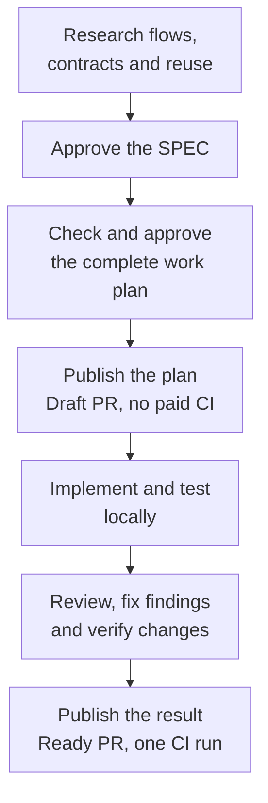

# Implement the planctl development process

## Goal

Research and agree the intended behavior once, then implement, verify and review it without routine owner questions. Plans explain the goal, system behavior, flows and contracts in plain English. Publication produces an approved-plan draft without paid CI and a complete, reviewed implementation with one final CI run.

## How the system works

Interactive work stays interactive: inspect code, discuss a decision, edit the requested document or code, verify the change. It does not create a plan automatically.

For planned autonomous work, extend the existing planctl MCP server. Keep its SPEC and implementation approvals and its task operations. Add three operations already discussed: `check_plan`, `execute_plan` and `publish_delivery`.

The machine service owns continuation. The agent owns implementation inside the agreement. The publisher owns remote writes. A substantial change to agreed behavior, responsibility or ownership returns to the owner with a self-contained question.

## Implementation order

### 1. Make the authoring contract match the document the owner wants

**Change:** `planctl/src/core/plan-update.ts`, `planctl/src/core/plan-gate.ts`, `planctl/src/core/spec-submission.ts` and `planctl/src/mcp/server.ts`.

- Remove the unwanted introductory section from `SPEC_SECTIONS` and Stage guidance. Do not request it as either an error or advice.
- Make `GOAL_RULE` ask for the observable result. Make `TARGET_RULE` ask for the mechanism: trigger, ordered operations, owning functions, changed data, failures and tests.
- Return goal followed immediately by system behavior and readable flows. Keep full changed interfaces, canonical names, owning files and verification.
- Return all findings together, with the relevant quotation. Do not replace the owner's terms or silently rewrite the draft.
- Preserve existing approved documents and their hashes. The new authoring contract applies to new work; it does not rewrite history.

**Proof:** initialize and submit a plan without the removed section; inspect both MCP and CLI replies; approve it without a request to add that section. Existing approved documents still verify. Render the example at a 1024-pixel viewport.

The section-list and Stage-hint removal is already implemented locally. The remaining authoring guidance is part of this proposal.

### 2. Give MCP and installed hooks a compatible runtime

**Change:** `shared/code-production/agent-stack.ts`, its hook templates, `planctl/src/core/plan-progress.ts`, the existing installer and MCP startup/write paths.

- Record journal and lock format compatibility alongside the installed source revision. A different commit alone is informational.
- Check the reader used by the actual installed hook before the first plan write in a repository, including interactive documentation work.
- Add a runtime-only installation option to the existing installer. It selects an explicit committed source revision and updates the runtime and compatible hooks together. It does not copy skills, instruction files or CI workflows.
- Validate the selected files before installation, preserve the previous working set for rollback, and record the installed component revisions accurately.
- Check the running MCP instance as well as files on disk. Reconnect through the owning host's supported mechanism; never kill another session's process.
- Exercise the write, commit and cleanup sequence in a disposable repository under the intended permissions. Check dependency and cache paths as part of this probe.

**Proof:** reproduce the old reader/new writer mismatch before a real plan is changed; repair the selected runtime; perform two journaled commits without journal copying or manual cleanup. Leave an unrelated historical journal untouched. Verify that direct plan edits still fail and that runtime-only repair preserves instruction files byte for byte.

The journal reader repair and cleanup regression are already implemented. Automatic compatibility checks and scoped installation remain to be implemented.

### 3. Resolve implementation boundaries before execution

**Change:** `planctl/src/core/plan-gate.ts`, `planctl/src/core/plan-update.ts`, `planctl/src/core/spec-submission.ts` and the MCP tool definitions. Add `planctl/src/core/plan-check.ts` to own the checks shared by approval and completion.

- `check_plan` takes the plan and its current revision. Resolve every Delivery in its own checkout and inspect the proposed changed declarations, canonical definitions and callers.
- Check dynamic consumers with named behavior tests. A reference search is evidence of coverage, not proof that every consumer was found.
- Check compatibility decisions, dependencies, verification commands, baseline failures and runtime prerequisites. Return concrete findings in one response.
- Reuse the same contract comparison before approval and at completion. Preserve an existing protocol field's spelling when the agreed contract preserves it.
- Change `parentRefusal` to accept verified local completion of a prerequisite. Local implementation must not require a parent PR or remote CI. An explicitly external dependency still needs its recorded evidence.
- Record newly discovered files when they complete agreed behavior. Require an owner decision for a new public contract, responsibility, architecture or module boundary.

**Proof:** find the omitted routing-key readers and omitted type changes before approval; accept declared protocol names; continue into the next repository after local prerequisite completion without a PR. Refuse a genuinely new undeclared contract. An old failing required test remains a failed requirement, not a passed deviation.

### 4. Make vocabulary and reuse part of research

**Change:** extend the existing `vocabulary` MCP operation and `authoringContract`. Reuse `shared/code-production/vocabulary.md` and project dictionaries. Add `planctl/src/core/vocabulary.ts` and `planctl/src/core/jev.ts` for evidence lookup and the Jev API call.

- A dictionary entry records the canonical term, meaning and definition location. Ordinary local variable names need no entry.
- Preserve the current synonym entries while extending their reader. Migrate a project dictionary only as a visible, scoped change; do not rename existing concepts during installation.
- A candidate request contains the proposed name, responsibility and goal it serves. It works before a plan exists.
- Return matching definitions, relevant code, inspected revisions and search coverage. Compare inputs, outputs, effects and callers before choosing reuse or extension.
- Ask Jev explicit binary questions about duplicate responsibility and contradiction with a cited definition. Return each probability with its evidence; there is no universal plan-quality number.
- Cache exact questions and evidence, batch independent questions, and invalidate changed inputs. Configure the call budget and verify the current API contract before enabling live calls.
- Keep semantic results advisory initially. Missing API access or uncertainty does not reject otherwise valid work. Deterministic contract errors remain errors.
- Include proposed dictionary changes and new contracts in SPEC approval. A different spelling cannot authorize a duplicate responsibility.

**Proof:** an existing concept is found under a proposed synonym; a justified new concept remains distinguishable; repeated unchanged checks make no new API call. Test good examples and defective variants separately, report false refusals, missed defects, latency and actual cost.

### 5. Continue the owned execution through verification and review

**Change:** extend `MachineStore` in `planctl/src/machine/state/machine-store.ts` and register `planctl/src/machine/execution.service.ts` in the existing machine module. Extend MCP with `execute_plan`; reuse the current session identities, task records and event log.

- Starting execution binds the approved revision, worktree, provider session and process identity. Repeating the request resumes that execution instead of creating another worker.
- Persist the next action and observed completion before starting another action. On restart, reconcile actual task, process and Git state before retrying.
- After an idle turn, continue the same owned session when eligible work exists. Never adopt, resume or terminate an unrelated process.
- After the last task, continue through complete local verification, final review, fixes and verification of affected changes. Task completion is not the end of execution.
- Reuse a passing check only when its command and complete input fingerprint match. Record unavailable evidence honestly.
- Respect owner pause and cancellation. Bound recovery attempts without verified progress; record the actual blocker and continue independent work. An open-checkbox count is not a reason to restart forever.

**Proof:** stop a worker between tasks and after its last implementation task; resume without repeating completed changes. Restart the machine service. Verify owner pause, duplicate requests, an unrelated live session and a persistent tool failure. A routine local retry produces no owner question.

### 6. Put review before publication and enforce the publication budget

**Change:** MCP `publish_delivery`, `shared/code-production/templates/hooks/pre-push`, the managed workflow template, the existing server authentication/persistence path and `planctl/src/server/publication.service.ts`.

- The approved autonomous agreement authorizes two publication purposes per Delivery: the approved planning artifacts and the verified implementation.
- Store approvals and publication records outside the worker-writable checkout. Run the worker without GitHub write credentials. The publisher has the restricted credential and accepts only a recorded plan, destination, revision and permitted transition.
- Bind publication authority to the owner's actual confirmation and the reviewed plan revision through the trusted host. An `ownerWord` string supplied by a worker is not sufficient to create that authority. Reuse the existing plan-approval interaction rather than requesting approval for each publication.
- Keep the pre-push hook for immediate feedback. Verify the credential boundary by attempting direct `git push` and `gh` writes from the worker.
- For the planning publication, push the approved artifacts and create a draft PR. For implementation publication, require complete local checks and resolved review findings, push the final result while the PR is draft, then mark it Ready.
- Gate paid jobs before allocating a runner. Check every applicable workflow, including push-triggered workflows; an `if` on the last test step is insufficient.
- Persist a pending action before each remote write. After a timeout, inspect remote state before retrying. Never repeat a push or Ready transition just because its response was lost.
- Observe CI through the Actions API for the exact published commit. A failure does not authorize another push or paid rerun.

**Proof:** the draft publication allocates no paid runner; intermediate publication and direct worker writes are refused; implementation publication requires local review evidence; duplicate calls and lost responses produce one remote transition and one CI run.

This rollout is prepared locally. Before its first remote publication, inspect the existing workflow policy. If that policy would run paid jobs for a draft, its bootstrap change needs an explicit owner-approved publication; the new workflow cannot be assumed active before it is merged. Do not spend CI while developing this repair.

### 7. Install the agreed instructions and prove the complete flow

**Change:** only the instruction sources listed below, their existing installation paths, and end-to-end regression coverage. Install the reviewed versions after the runtime and workflow prerequisites pass.

- Apply the listed instruction changes to the last owner-approved content. Exclude earlier unapproved instruction rewrites and unrelated local changes from the release; a runtime update cannot approve them.
- Run the source MCP against installed hooks in both application and catalog fixtures. Test in a fresh checkout without old absolute worktree mappings.
- Verify completed cross-repository results against their recorded merged history after temporary worktrees and feature refs are removed.
- Exercise research, both approvals, draft publication, autonomous execution, local verification, review, final publication and observation of CI as one flow.
- Run the same exercise for an interactive documentation edit: no automatic plan, no publication, no request to copy or clear journals.
- Read real tool output and necessary owner questions. A function-level green result does not prove that the user-facing flow is understandable.

**Proof:** no routine owner questions after execution approval; no hidden change of scope; zero intermediate publications; no paid draft CI; one final CI run. Measure elapsed time, owner-wait time, repeated checks and publication count from recorded events.

## Exact instruction changes proposed for approval

These are targeted replacements, not a rewrite of Blueprint or project architecture documentation.

**Shared entry rule, `claude/CLAUDE.md` and its `codex/AGENTS.md` link, plus the explicitly selected project instruction copies:**

> Follow the owner's requested way of working. Discussion, research, documentation and iterative edits do not require a plan. Use Blueprint and planctl when the owner requests planned autonomous implementation. Keep the naming, verification, scope and publication rules in both cases.

**Blueprint, `shared/skills/blueprint/SKILL.md`:**

> Research the affected flows, canonical contracts and reusable implementations before submitting the SPEC. Write the observable goal, then explain system behavior and flows, changed interfaces, owning files and verification. Resolve substantive design choices before asking for approval. Check the complete work plan before its approval.

**Execution, `shared/skills/blueprint-start/SKILL.md` and the shared development-process rule:**

> Complete the approved behavior autonomously, including mechanical callers, scoped tests and ordinary repairs. Record actual paths and results. Ask only when a discovery changes the agreed behavior, public contract, responsibility or ownership. A rejected tool operation is diagnosed before it becomes an owner question.

**Both `review-implementation` skill copies:**

> Start the final implementation review after complete applicable local verification on the reviewed revision. The approved autonomous work plan includes this review. Resolve findings and verify affected changes before implementation publication. Remote CI follows publication and is not an entry condition for review.

**Vocabulary rule, linked from shared and project instructions:**

> Before introducing a domain or architectural name, check the dictionary and relevant code through planctl. Reuse or extend an existing mechanism when it meets the requirement. Declare a justified new concept and its canonical definition for approval. Semantic scores provide evidence, not permission.

**Necessary questions, one shared `/ask-user` skill:**

> State the feature, the discovered fact, the decision, viable options and their consequences, and a recommendation. Quote and link a relevant source. The question must make sense without reading previous messages. Internal stage identifiers, unexplained symbols and raw tool output do not explain a decision.

## Completion boundary

The process is delivered when the source changes, compatible installed runtime, instruction copies, worker permissions and workflow behavior pass the complete exercise. A source commit or an updated document alone is not delivery.

The section removal and journal repairs are local completed changes. The remaining mechanisms above are the implementation proposal. No approval, rollout, push or successful CI run is implied by this document.
