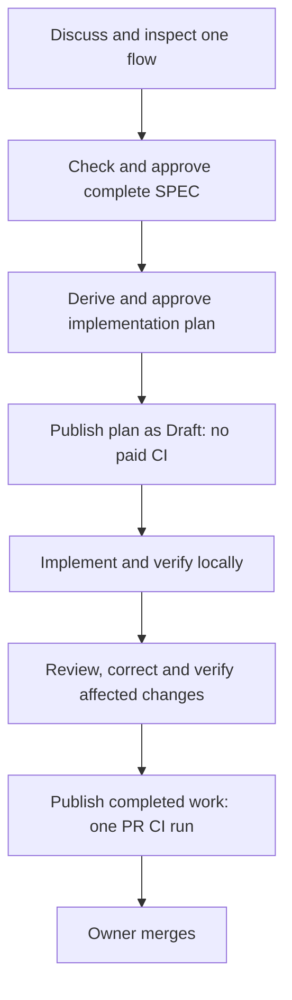

# Repair planctl without replacing the working process

Historical design and incident record. The current isolated implementation and its measured evidence are documented in [the trial guide](planctl-trial.md). Statements below about pending work describe the earlier review boundary.

## Goal

Let the owner develop software: discuss the destination in small readable steps, approve the complete SPEC and implementation plan, then receive locally verified and reviewed work. Routine implementation and tool bookkeeping must not consume owner decisions. Preserve existing behavior, contracts and canonical names. Spend CI only at the agreed publication boundary.

Status: repair proposal, reviewed against the source and the October 19–20 incident. This document is not a recorded owner approval. The narrow incident repair below was explicitly requested and has been implemented locally. The remaining changes are not installed.

## Target

Interactive discussion, research and document editing stay interactive. For planned autonomous work, the agent develops Goal and Target with the owner, records decisions and evidence in the same research document, then uses the existing MCP operations. Goal states the outcome; Target describes the finished behavior, flows, responsibilities and contracts. The starting code revision defines the starting state.



Keep `init`, `submit_spec`, `approve_spec`, `put_delivery`, `put_stage`, `approve_plan`, `start_task`, `complete_task`, `close_stage`, `needs_owner` and `resume_task`. Retain English, declared changed public contracts, useful Blueprint examples, TDD, meaningful acceptance tests and enabled Git hooks. A local draft commit is allowed but is not a new approval or publication.

The reviewed historical Blueprint baseline is `acabd4288ede3857311dcd26915897e392327097` (`a50b18d^`). Compare focused edits against it and the consumer's current instructions. Do not reinstall the whole dirty rollout branch or treat the later wholesale shortening as approved.

## Work and acceptance, in order

### 1. Remove the reproduced approval/commit contradiction

**Implemented locally; source and consumer checks recorded in the incident report.** The MCP writer allows agreement before the first plan commit. The old freeze assumed that any newly committed APPROVED file had never been reviewed. These rules contradicted each other.

MODIFY `planctl/src/core/plan-gate.ts`: protocol plans use their existing mutation journal and lock hashes; legacy plans keep the parent-diff freeze. Refuse a missing journal, changed staged bytes, wrong base, broken chain, changed locks and removal of protocol markers. No new permission, approval type or public API is introduced.

MODIFY `planctl/test/mcp.test.ts`: drive real stdio MCP through both approvals and the installed Git hooks. Exercise all 16 combinations of journal presence, staged-byte identity, chain integrity and base identity. A refused commit preserves approvals and HEAD. A valid retry and an authorized amendment commit successfully. Keep the existing legacy merge and raw-edit regression tests.

MODIFY `planctl/test/plan-update.test.ts`: correct an independently pre-existing assertion on obsolete error wording; continue requiring a useful refusal for missing Stage description.

MODIFY only the corresponding block in `magnis-app/.worktrees/monorepo/.agents/code-production/runtime/plan-gate.ts`. Test its exact runtime and hooks in disposable repositories before use. Preserve plan, index entries unrelated to repair, skills, permissions and workflows. Do not delete/recreate an approved plan to recover from a failed operation.

**Step 1 → Verify:** the former first-commit failure is RED before the patch and GREEN afterward. All invalid journal combinations remain RED. Existing protection tests remain GREEN. Hash the consumer's instructions and plan before/after; require no changes.

### 2. Remove execution deadlocks in the existing runtime

MODIFY `planctl/src/core/plan-update.ts`, `planctl/src/core/plan-progress.ts`, `planctl/src/core/task-run.ts`, `planctl/src/core/plan-gate.ts` and `planctl/src/mcp/server.ts`. MODIFY `planctl/test/plan-update.test.ts`, `planctl/test/plan-progress.test.ts`, `planctl/test/task-run.test.ts`, `planctl/test/plan-gate.test.ts` and `planctl/test/mcp.test.ts`. No new scheduler or execution service is required for this repair.

- `parentRefusal` must accept verified local completion of a prerequisite. Starting local work must not require a parent PR or green remote CI. Genuine external dependencies retain explicit evidence requirements.
- `progress` and `start_task` must use the same eligibility calculation across repositories. An owner wait blocks its task and actual dependents; eligible independent work continues. Once none remains, report the concrete unresolved decision once. Never spin because checkboxes remain open.
- Completion checks compare public contracts with the agreed SPEC. An unchanged declaration moved between files does not become a newly invented contract; an approved rename uses the declared name mapping. A new public contract or responsibility still needs agreement. Do not silently waive undeclared semantic changes.
- Additional mechanical consumers within an agreed responsibility go into execution evidence with their reason. Locked meaning stays unchanged. Crossing an unapproved module boundary is a substantive decision.
- `deliveryRoot` resolves the owning repository for commits, types and checks. Hook children clear inherited Git-local variables. Verify result commits from configured repository history, not a disposable absolute worktree path. Missing history is an actionable unavailable check, never a fabricated success.
- Persist checkpoints and pending questions using existing task-run records. Resume a task from those records, not from an open-box count. This restores continuation while the agent session is running; restarting an exited agent is a separate host capability and is not claimed here.
- Bind each approval to the revision the owner saw. Extend the existing approval inputs with a required `expectedRevision: string`: SPEC hash for `approve_spec`, implementation hash for `approve_plan`. Compare it inside the same serialized mutation as the lock. A stale request changes nothing. Repeating an already recorded approval for the same lock returns its current state without another mutation. Roll out the updated tool schema and reader together; never reinterpret a missing revision as the latest one.

**Step 2 → Verify:** finish a prerequisite locally with no PR and start its dependent in the second repository; block one task on a real product decision and finish an independent task; restart the MCP process and recover the same wait once; move an unchanged type successfully but reject an unapproved contract change; delete the temporary worktree and verify receipts from a fresh checkout with configured history. Run criteria in execution, never in `--no-exec` CI receipt validation. A known required failing test remains a failure.

For approval concurrency: present revision A, save revision B, then send approval for A; require a refusal with no lock or journal change. Submit two approvals for the same current revision concurrently; require one recorded transition and the same successful state for the retry. An approval for one section must not lock the other section. Keep these as MCP boundary tests, not checks of explanatory strings.

### 3. Align only the conflicting instructions and installed components

MODIFY `shared/skills/blueprint/SKILL.md`, `shared/skills/blueprint-start/SKILL.md`, `claude/skills/review-implementation/SKILL.md`, `codex/skills/review-implementation/SKILL.md`, and the matching clauses in `shared/code-production/laws/development-process.md` and `shared/code-production/laws/plan-format.md`. Prepare exact diffs against the preserved baseline before installing them. Also correct the stale CI-before-review clause found in `magnis-app/.agents/skills/fast-precommit/SKILL.md`; do not rewrite that skill. Apply the research-entry and naming rule to the selected trial's `AGENTS.md` only after its exact diff is agreed.

- Research one coherent behavior or decision at a time. Keep the complete Target current and link readable diagrams through mdurl. No mandatory introductory justification or automatic plan for ordinary dialogue.
- Before approval, inspect actual producers, consumers, protocol names, compatibility policy, relevant baseline test failures and required permissions. Every requirement maps to work and evidence. The owner receives a short decision summary with access to the full contracts.
- Record the owner's exact agreement and its scope. Agreement with one point does not approve the whole document. A technical retry with unchanged approved content does not require a new design decision. Never interpret a permission refusal as proof that the owner did not agree.
- Ask a self-contained question only for a material change: feature context, quoted conflict, concrete options, consequences and recommendation. Internal task IDs cannot be the explanation.
- Final requested review follows the complete local gate. Fix findings and rerun affected checks before implementation push. Remote CI is never an entry condition for local review.

MODIFY `shared/code-production/agent-stack.ts`, `shared/code-production/agent-stack.test.ts`, `planctl/test/setup-code-production.test.ts` and `lib/setup-code-production.sh` to select a runtime-only installation. Stage a complete version, validate it, then activate it; an interruption retains a coherent version. Do not copy skills during a runtime repair. Verify actual capability/protocol compatibility rather than demanding an update merely because commit IDs differ.

MODIFY `planctl/src/cli/main.ts` and `planctl/test/package-boundary.test.ts` only for the already reproduced installed-runtime dependency issue. A clean consumer must run hook commands with Bun auto-install disabled. Required write locations and MCP registration are checked before execution; no mid-task temporary scripts or manual journal copies.

**Step 3 → Verify:** a documentation discussion creates no plan; a feature discussion retains decisions across restart and produces two explicit approvals; the exact installed MCP plus hooks completes a fixture with zero routine questions. Interrupt runtime installation, recover, and compare skills/plan/journals byte-for-byte. Verify the real host separately: unit tests cannot prove its sandbox or automatic approval behavior. Initial trial stays in the existing isolated checkout; other agents keep their current setup.

### 4. Control publication and CI without disabling useful checks

Extend the existing MCP with `publish_delivery`, backed by the existing planctl server authentication and persistence. CREATE `planctl/src/server/publication.service.ts`, `planctl/src/server/publication.controller.ts` and `planctl/test/server-publication.test.ts`: one effect owner, one authenticated HTTP boundary and its fault tests. MODIFY `planctl/src/server/persistence/server-store.ts`, `planctl/src/server/app.module.ts`, `planctl/src/server/main.ts`, `planctl/src/config/config.ts`, `planctl/src/mcp/server.ts`, `planctl/src/machine/transport/server-client.ts` and `planctl/deploy/planctl-server.service`. Reuse existing machine authentication at `POST /v1/machines/:machineId/publications`; restrict it to that machine's configured repositories. Publication must not require Telegram configuration. No second server application or general command runner.

Proposed public inputs and results, declared here before implementation. These two names describe the one new operation; they are not a new domain hierarchy:

```typescript
interface PublishDeliveryInput {
  readonly plan: string;
  readonly delivery: string;
  readonly specRevision: string;
  readonly implementationRevision: string;
  readonly purpose: "plan" | "implementation";
  readonly commit: string;
  readonly expectedRemoteHead: string | null;
}
type PublishDeliveryResult =
  | { readonly status: "published"; readonly commit: string; readonly prUrl: string }
  | { readonly status: "pending"; readonly operationId: string; readonly nextCheck: string }
  | { readonly status: "refused"; readonly reason: string; readonly evidence: readonly string[] };
```

The server resolves repository/base/branch from the registered Delivery and checks both locks. It imports the exact Git object into its own bare repository from a configured read-only local checkout using filesystem read permission; the worker never receives the publisher's token. Remote-machine upload is outside this initial same-host deployment. The publisher invokes Git only on its own configured repository and fixed destinations, never an arbitrary worker-provided command. Pin the commit before validation; later worker edits cannot change that object. Verification and review evidence identify their complete input trees and commands; unchanged inputs may reuse a passing result, otherwise they are stale. Evidence remains cooperative-agent evidence, not attestation against a malicious agent.

The operation identifies the registered repository, branch, base, plan, agreed revision, purpose (`plan` or `implementation`), exact commit and expected remote head. Its durable record stores a stable operation key, request identity, pending remote effect and observed result. Same key/different request is refused; lost responses are reconciled from remote state before retry. A transaction claims each publication purpose once. Amendments/restarts do not reset the budget.

- Plan publication: the approved planning artifacts, Draft PR, zero paid product CI jobs.
- Implementation publication: clean candidate, complete required local evidence and resolved final review, exact candidate commit. Push while Draft, then mark Ready once. No merge operation is exposed.
- Two repositories: upload all required candidate histories while Draft before making a dependent PR Ready. Retain successful uploads when another fails; never force-push a competing change.
- Observe the final Actions result on the published commit. A failed run does not authorize another push or rerun. An additional attempt needs a specific allowance, not a reset of the original budget.

A pre-push hook supplies early feedback; it is not a credential boundary. The publisher must run under a distinct OS identity holding the GitHub App credential, outside worker-readable files/environment. Agents receive no direct GitHub write token. The App may write feature branches and PRs but cannot bypass main/staging rules. Owner-only merge requires that distinct identity; the existing shared owner PAT cannot enforce it. Prepare exact deployment and repository-rule changes for the owner to apply where administrator permission is required.

MODIFY `shared/code-production/templates/hooks/pre-push`, `shared/code-production/templates/github/code-production.yml`, `magnis-app/.github/workflows/ci.yml`, `magnis/.github/workflows/ci.yml` and `0_agents/.github/workflows/planctl.yml`. MODIFY the existing stack, MCP, config and server-main tests; add event cases to `magnis-app/scripts/tests/ci-lane-contract.test.ts`. Preserve required check names. Every paid PR job, including classifiers/aggregators, is guarded before runner allocation. Add the Ready event where missing. Preserve post-merge release jobs and report their separate cost; one PR CI run does not mean all future release CI is free. Do not disable a repository's entire CI to resolve a planning failure.

**Step 4 → Verify:** use a fake GitHub endpoint and temporary bare repositories: 10 concurrent duplicate requests, lost push response, stale candidate, changed remote head, missing review, failure of the second upload and restart between push/Ready. Count actual remote effects, not tool invocations. No protected-ref write, merge, duplicate publication or unbudgeted CI retry succeeds. Verify workflow event predicates locally. A live bootstrap that could spend CI needs the owner's specific permission; do not claim the policy active before it is installed on the remote default/base branch.

## Dictionary and Jev: retained, outside the recovery dependency chain

Use current `vocabulary` and existing canonical definitions during research now. New domain names and changed public contracts belong in the SPEC; local variable names do not need approval. Compare sufficient extension, unnecessary rewrite and incomplete small patch against the whole requirement. A smaller diff cannot compensate for missing behavior.

After the core path is stable, extend `vocabulary` with a candidate name, responsibility, Goal and cited definitions. Reuse that evidence builder for optional `submit_spec` feedback. Jev answers a bounded question about duplication, requirement coverage or contradiction; it cannot approve work or mark a check passed. Missing API/budget gives unavailable advice and leaves deterministic checks running.

Keep exact-input/revision/model caching, request/cost bounds and source-separated calibration examples from the previous proposal. Compare against lookup without Jev; report false warnings, missed defects, coverage, latency and actual cost before enabling advice. Do not make a new score, semantic gate or calibration project a prerequisite for working on product code.

## Proof obligations and completion

Let `J` mean the journal exists, `B` that it belongs to this plan/root/base HEAD, `H` that staged bytes match its candidate, `C` that its hash chain is continuous, and `L` that approved-section locks match. For protocol commits:

`protocol_freeze_allowed = J ∧ B ∧ H ∧ C ∧ L`, with the existing verified merge-inheritance exception. Language and project checks still apply before the whole commit can succeed.

The repair exhaustively checks the 16 combinations of the first four conditions with valid locks, plus the existing lock/legacy/merge tests. A rejection has the invariant `HEAD_after = HEAD_before` and retains approval bytes. This proves the checked finite cases and makes the implementation contract explicit; SHA hashes do not establish a human's intent.

For the remaining flow require:

- `start(task) ⇒ approved_scope ∧ verified_local_prerequisites ∧ correct_repository`.
- `eligible_work ≠ empty ⇒ no whole-plan owner wait` while the owned session runs.
- `publish_implementation ⇒ complete_local_evidence ∧ resolved_review ∧ exact_candidate`.
- `publication_count(delivery) ≤ 2`, `paid_premerge_CI_attempts(delivery) ≤ 1` without an additional allowance.
- No worker credential can write protected refs or merge. A tool instruction alone does not prove this.

Test each implication through the actual boundary and retain counterexamples from the old behavior. Conditional liveness needs a running/fair executor, terminating checks and answers to genuinely new product questions. Neither model helpfulness nor universal first-run CI success is mathematically provable here.

The process is restored only when an isolated two-repository fixture completes through MCP, installed hooks, local checks, requested review and simulated publication, with no routine owner questions; an interactive edit stays interactive; faults preserve state; and the real host permission probe passes. Report simulation and live evidence separately. Roll back only selected files if a regression appears. No global rollout, skill rewrite, paid CI or owner merge is implied by this review proposal.

## Verification commands and review record

Run scoped `bun run agent:test:backend -- <the listed test files>` from `0_agents/planctl`, then `bun run typecheck` and `bun run lint`. The incident specifically runs `bun run agent:test:backend -- test/mcp.test.ts -t tst_unit_planctl_mcp_011`; legacy protection runs `test/plan-gate.test.ts` and installed hooks run `../shared/code-production/agent-stack.test.ts`. Consumer commits run their existing hooks. Run the complete `bun run agent:verify:pr` once at publication, then requested implementation review, corrections and affected verification. No paid CI is part of local repair development.

Self-review round 1 found three real omissions: the equation described the whole commit instead of the protocol check; approvals lacked an explicit stale-revision guard; the publication proposal lacked its transport, exact contract and commit-transfer boundary. These are corrected above. The previous longer design is retained in the incident backup, including Jev evaluation detail. This repair proposal does not silently discard that research or install its unimplemented features.

Round 2 found that the new approval revision guard lacked an explicit race/retry acceptance scenario; the scenario is now in Step 2. Review distinguishes the completed incident patch, the proposed runtime/instruction repairs and the later credential/CI deployment. Local simulation cannot certify host permission behavior or remote policy.

APPROVED — Codex self-review passed in round 3. This verdict reviews the repair proposal; it is neither owner approval of changes nor a claim that the remaining mechanisms are implemented.
