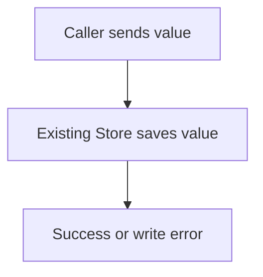

# planctl: isolated working trial

## Goal

Discuss a readable solution, preserve canonical names and contracts, then implement without routine owner questions. Keep local checks focused; review precedes the implementation push and CI. Only the owner merges.

## Use the process

1. **Discuss one behavior.** Ordinary work stays interactive. `vocabulary` reads names and their canonical code. `check_content` checks one flow together with its interfaces and example; no plan is required.
2. **Correct the proposal.** Factual findings cite the offending declaration. Jev answers a focused binary question with probability, evidence and uncertainty. The agent corrects ordinary problems itself. A semantic answer cannot grant approval or certify a requirement.
3. **Approve the solution, then its breakdown.** `submit_spec` keeps an incomplete draft saveable. `approve_spec` and `approve_plan` require the displayed revision and the actual approval scope. A vocabulary proposal is written with SPEC approval through the same recoverable journal. One paragraph's approval does not approve the whole document.
4. **Implement locally.** Existing Task operations and checks remain. Multiple work commits may belong to a Stage. New plans use one Stage per PR. A completed local dependency can unlock the next work before CI. Missing required values and real contract changes remain explicit.
5. **Finish the PR.** Complete local gate → agreed review → fixes and affected checks → `publish_delivery` → CI. A retry reconciles an already pushed head. One diagnosed CI correction is allowed after the existing Actions observer confirms failure, the cause is recorded, and fresh local checks pass. Intermediate commits stay local. The publisher has no merge operation.

The source changes remain on the existing feature branch. No global client configuration or installed consumer instructions were updated. The trial's current source must be selected explicitly in a separate MCP session.

## One measured flow

**Goal:** save a value through the existing persistence owner.

- Before: introduce `ValueStoreAdapter` with another implementation of the same responsibility. The dictionary identifies `Store` as the canonical owner. Jev's answer to “Does this preserve Store as the single owner?” was **0.13**.
- After: the caller uses the existing `Store.save`; a successful write returns, a failed write stores nothing. Jev returned **0.97**. No deterministic findings remained.



```typescript
interface Store {
  save(value: string): void;
}
```

The demonstration used a real stdio MCP client, the pinned Jev API and Chromium. The browser produced an SVG and screenshot. Rechecking reused evidence; repeated SPEC approval preserved the existing agreement. [Read the saved example](http://u3775:6420/dev/2026-10-20-isolated-trial).

## MCP contracts

Existing tools keep their names. These additions operate alongside them:

| Tool | Input → result |
|---|---|
| `vocabulary` | repository → entries, meanings, forbidden synonyms, canonical declarations and revision |
| `check_content` | goal, flow/code, optional focused questions → factual findings, semantic advice, diagram artifacts |
| `submit_spec` | expected draft revision, SPEC, optional vocabulary proposal → saved draft and the same checks |
| `approve_spec`, `approve_plan` | displayed revision and actual owner word → recorded approval; stale input changes nothing |
| `publish_delivery` | plan, Delivery, checked head, publication phase, optional relative `reviewPath` → PR URL and whether a push happened |

When final review is requested, set `put_delivery.review` to `required`. Save the actual review as a normal local artifact, for example `.tmp/planctl-review.md`, with `Reviewed-Head: <actual head>` and `REVIEW VERDICT: APPROVED`. Pass `reviewPath` rather than asking the owner to write inside Git metadata. The report must describe the review actually performed. Other deliveries do not acquire a review requirement automatically. The complete gate is the command declared by the Delivery; `close_stage` records its successful execution and preserves failed command logs for diagnosis.

## Evidence and calibration

- Inventoried **302 historical Markdown paths across four repositories**, plus 67 other historical paths. This is a source inventory, not a claim to have read every version.
- Historical corpus: **24 focused questions**, 18 calibration and 6 independent evaluation cases. Variants of a source stay in the same split. On the six evaluation cases: **4 correct decisive answers, 2 inconclusive, 0 decisive errors**. Small, provisional labels do not establish general accuracy.
- The historical run through `check_content` took 24 API calls. Replaying unchanged inputs made **0 calls**. Its conservative estimated input-cost upper bound was **$0.0102 for the entire run**; provider billing was not independently verified.
- Public corpus: 24 independently runnable **synthetic regression examples**, organized by contracts, reuse, ownership, accounting, compatibility and failure behavior. It is not a replacement for historical evaluation. The public report records every answer and uncertainty.
- Jev is pinned to `jev-1.13.0`. At most 12 questions and 48 KB per request, a five-second timeout, no automatic retry, and an estimated cost ceiling of $0.01 per request. Exact question, goal, evidence, dictionary revision, rubric and model identify the cache.

There is no weighted “quality number” presented as truth. Factual contract failures remain separate from semantic probabilities. The owner's zero-score example is a regression: goals without operation contracts are saved as an incomplete draft and cannot masquerade as a complete solution.

## Try and reproduce

From `planctl/`, use the existing `agent:*` checks. The optional scripts are:

```bash
bun bench/evaluate.ts          # validate the public corpus; no network
bun bench/evaluate.ts --live   # explicitly call Jev with TYPESAFE_API_KEY
bun bench/trial.ts             # isolated live MCP example; preserves its evidence
```

For a separate client session, launch this checkout's `planctl/src/cli/main.ts mcp`. `--event-log <path>` selects a writable diagnostic log for that session. Use the existing Jev key through `TYPESAFE_API_KEY`; never paste or store it in documentation. Chromium or Google Chrome enables rendered diagram checks; absence is reported as unavailable, not passed.

The historical dataset, exact source excerpts and raw conversation labels remain in the local evaluation archive. They are excluded from this public repository. The public runner accepts `--corpus <file>` for that archive.

The final review found and corrected real interruption paths: unchanged type copies now pass task completion as well as the diff checker; a new dictionary definition can refer to its declared future implementation; pending dictionary transactions recover before another plan writes. Kernel file locks serialize writers and release automatically if their process dies. Existing public function signatures and their local type dependencies are compared too.

## Limits

- Semantic feedback is advisory. Two independent defects were inconclusive. No threshold was tuned against those evaluation answers, and no provider fine-tuning is claimed.
- The contract checker compares declared TypeScript members, aliases, existing public function signatures and local type dependencies. It does not exhaustively resolve cross-file inferred schema impact or prove arbitrary TypeScript semantic equivalence. Typechecking and behavior tests remain necessary.
- Local hooks enforce the publication record when this template is installed in the selected checkout. They are a cooperative workflow control, not a security boundary against an agent that can edit hooks or use another credential. Remote protected-branch rules remain necessary.
- A plan-only push is refused unless tracked workflows prove that it will not trigger product CI. The readable SPEC URL is available without a push.
- Sandbox and client permission policies remain host controls. No universal promise that all clients show zero permission dialogs is made. Diagnostic-log failure now reports a warning while preserving the actual operation and its transaction journal.
