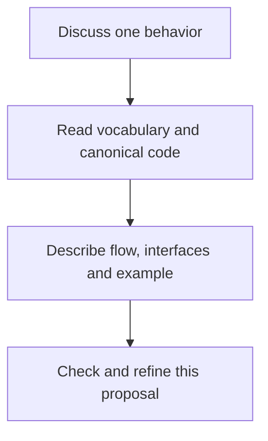
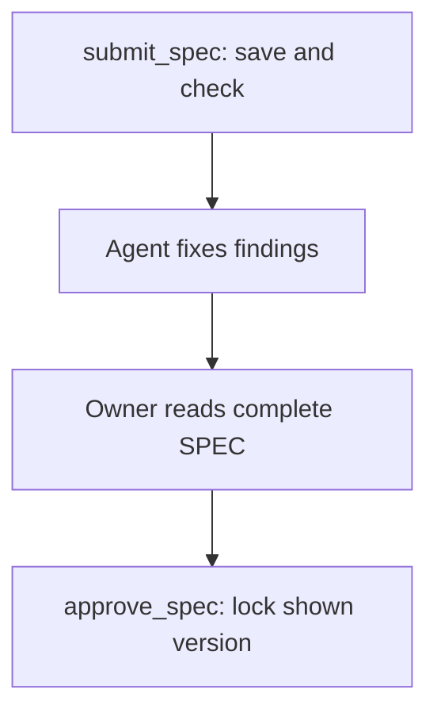
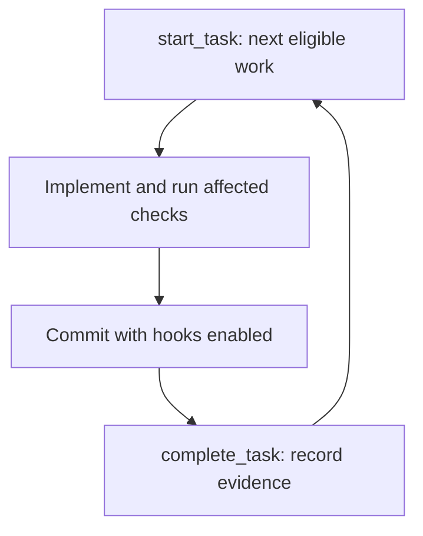
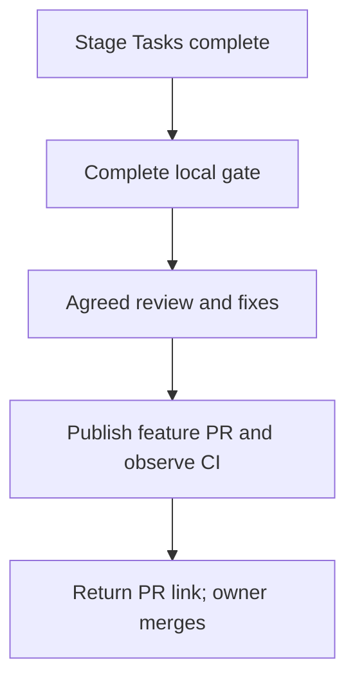

# Fast autonomous development with clear plans and a shared vocabulary

Status: APPROVED  
Spec lock: sha256:42d5c83d5f6f00b6eed26325e93070f883049afbe171c62079ad638c5fdd2e64 owner:Я тебе даю полный карт-бланш.  
Outline lock: unlocked  
Implementation lock: sha256:7ac87778ad9b08519b334bf737b6221d57f875231cc932a519995e07ca3ebf34 owner:Я тебе даю полный карт-бланш.  
Active Delivery: D1  
Unattended decisions: allowed  
Ledger: implemented  

<!-- plan:spec:start -->
## The Goal

Deliver the agreed software quickly, with a solution the owner can understand and execution that does not require routine intervention. Aim for 20–60 seconds of affected checks during work; run the complete local gate at the Stage's PR boundary.

## The target

**Interactive work is the default. Blueprint starts only when explicitly requested.** Discuss the intended behavior in small pieces, inspect code and try examples. Keep decisions in the same document. Once the complete solution is understood, approve the SPEC, then approve its implementation breakdown. One Stage ends in one PR.

This is the proposed system specification. The final section distinguishes existing behavior from work still required.

### 1. Discuss a flow and find its existing names

The existing local **planctl MCP server** serves the agent's editor or terminal client. The agent researches and implements; the server reads canonical definitions, checks proposals and records approved work. Existing Git hooks call the same checks on actual code. Jev supplies bounded semantic advice; mdurl displays the document.



`vocabulary({ root })` returns the process terms and project definitions. The agent reads the cited declarations and their callers before introducing a name. Matching field shapes alone do not establish reuse.

#### Interfaces

Extend the existing `AuthoringContract`; preserve its existing section guidance and synonym pairs. These are its added members:

```typescript
export interface AuthoringContract {
  readonly entries: readonly VocabularyEntry[];
  readonly vocabularyRevision: string;
}
```

```typescript
export interface VocabularyEntry {
  readonly term: string;
  readonly meaning: string;
  readonly forbidden: readonly string[];
  readonly definitions: readonly {
    readonly repository: string;
    readonly path: string;
    readonly name: string;
  }[];
}

export interface VocabularyChange {
  readonly before: VocabularyEntry | null;
  readonly after: VocabularyEntry | null;
  readonly reason: string;
}
```

These two names describe a definition and its proposed change. Addition has no `before`; removal has no `after`; an update has both. Reject both-null changes.

Process definitions live in `shared/code-production/vocabulary.md`; project definitions live in `docs/vocabulary.md`. Absence is reported explicitly, never replaced with guessed definitions. Entries without forbidden alternatives remain valid.

Reuse canonical responsibilities and names. New types use PascalCase; new members use camelCase. Preserve established external wire names. Follow the existing TypeScript rules: interfaces for object shapes, aliases for unions and projections, no `any` or suppression-based escapes. A genuinely new concept explains its distinct responsibility and why reuse fails.

**Example:** reuse an existing provider registry when it already owns registration and lookup. Keep a distinct execution interface when it owns execution. Fewer names are useful only if required behavior remains complete.

**Stored result:** an unapproved flow and any vocabulary changes. Notes and code experiments do not create a plan. On an explicit Blueprint request, `progress({ root })` resumes an existing plan; otherwise `init({ root, title })` creates a draft.

### 2. Check the flow together with its interfaces

The new MCP operation `check_content` checks one discussion unit, with or without a plan. The same checker runs automatically during SPEC submission, amendment and approval.

#### Interfaces

```typescript
export declare function checkContent(input: {
  readonly root: string;
  readonly goal: string;
  readonly kind: "flow" | "code";
  readonly content: string;
  readonly source?: string;
  readonly questions?: Readonly<Record<string, {
    readonly type: "noul";
    readonly instructions: string;
    readonly criteria: { readonly true: string; readonly false: string };
  }>>;
}): Promise<Pick<SubmitSpecResult,
  "findings" | "semanticChecks" | "diagramChecks">>;
```

Extend the existing `SubmitSpecResult`; retain its revision, state, corrections, `GateViolation[]` findings and check status. Add:

```typescript
export interface SubmitSpecResult {
  readonly semanticChecks: readonly {
    readonly question: string;
    readonly probability: number | null;
    readonly evidence: readonly { readonly path: string; readonly quote: string }[];
    readonly uncertainty: string | null;
  }[];
  readonly diagramChecks: readonly {
    readonly line: number;
    readonly status: "rendered" | "failed" | "unavailable";
    readonly artifact: string | null;
  }[];
}
```

This declaration shows the added members, not a replacement for existing members.

The server performs these checks:

1. **Structure and contracts.** Each flow states its trigger/input, responsible component, operations, result and relevant failure handling. Its interfaces sit beside it. Collect declarations from every flow; resolve references to reused contracts. A flow changing no contracts says so.
2. **Facts.** Parse TypeScript and check it against canonical declarations and naming rules. Verify cited definitions and producer/consumer evidence. Findings identify the rule, location and exact excerpt; unresolved evidence is not a pass.
3. **Meaning.** Send Jev the relevant Goal, flow, declarations and cited dictionary/code evidence. Ask separately whether the flow covers the requirement, contradicts a definition or duplicates an existing responsibility.
4. **Diagrams.** Parse and render Mermaid in the existing browser environment. Return the SVG and inspect it at normal reading width for tiny labels, clipping and overlap. Parsing alone is insufficient.

The agent corrects findings and rechecks changed inputs. Incomplete drafts remain saveable. Proven structural/type errors block approval; Jev advice initially does not. Ordinary writing never acquires Blueprint's format.

**The first quality case:** a document containing only “discuss, approve, implement, test” must not be presented as a complete MCP design. Score solution coverage separately across component/state ownership, typed operation contracts and executable operation flow. A missing solution earns zero; good wording cannot compensate.

Use a versioned rubric with owner-reviewed examples. Keep source documents separate between calibration and evaluation; include necessary new concepts, real reuse, unnecessary rewrites and small but incomplete patches. Report missed defects, false warnings, uncertainty, latency and cost. Do not tune against the evaluation answers or treat a score as approval.

Cache exact questions, Goal, evidence, code/dictionary revisions, rubric and model version. Batch at most 12 questions into one request, with a five-second timeout and estimated USD 0.01 ceiling. If cost cannot be bounded, do not call. Unavailable access or invalid output returns null probability with a reason; deterministic checking continues. Cache renders by source, renderer, theme/fonts and viewport.

### 3. Save the solution and approve the exact SPEC



The Goal states the outcome. The Target describes the finished system: each flow, its adjacent interfaces and an example. Current code supplies the starting state. Research resolves compatibility, affected callers and required behavior before approval.

#### Interfaces

Extend the existing submission input with the proposed dictionary change:

```typescript
export interface SubmitSpecInput {
  readonly plan: string;
  readonly baseRevision: string;
  readonly ownerRequest: string;
  readonly spec: string;
  readonly title?: string;
  readonly vocabularyChanges?: {
    readonly baseRevision: string;
    readonly entries: readonly VocabularyChange[];
  };
}
```

`submit_spec` returns `SubmitSpecResult` from flow 2 plus the published URL. It saves proposals without applying dictionary changes. mdurl's reading view shows the SPEC; lock metadata and execution bookkeeping stay in the source record.

Extend `approve_spec({ plan, ownerWord })` with required `expectedRevision: string`. Recheck the displayed version and dictionary revision, then journal the approval and dictionary update together. Serialize competing updates; a stale revision writes nothing. Interrupted writes recover before reporting success. Extend the existing `MutationResult` with an optional `vocabularyFile: { path: "docs/vocabulary.md"; before: string | null; after: string }`. The existing mutation journal records the plan and dictionary before/after bytes before writing either file. The next MCP operation recovers only those bytes; conflicting edits remain refused. Serialize writers in the worktree and verify that the staged dictionary matches the approved proposal.

```typescript
export interface MutationResult {
  readonly vocabularyFile?: {
    readonly path: "docs/vocabulary.md";
    readonly before: string | null;
    readonly after: string;
  };
}
```

The owner approves behavior, scope, compatibility, proposed names and typed boundary contracts: fields, signatures, variants, optionality and nullability. Unchanged contracts use canonical references. Private domain duplicates also require a proposal; `export` alone does not define a boundary.

Agreement with one paragraph does not approve the whole SPEC. Preserve the owner's actual words; clarify only genuinely ambiguous approval scope. This produces `SPEC_LOCKED`, not implementation authorization. There is no outline approval.

### 4. Break the approved solution into executable work

The agent maps approved flows to Tasks and groups them into Stages. **One Stage has one PR**, with multiple local work commits when useful. Reuse the existing `DeliveryInput` as that PR's record, one-to-one with the Stage; preserve older plans' structure.

#### Interfaces

Reuse `DeliveryInput`, `StageInput` and `TaskInput` from `planctl/src/core/plan-update.ts`. An optional review field records whether final review is part of this Delivery; absence adds no new review requirement. `DeliveryMeta` exposes the same field to publication. The added members are:

```typescript
export interface DeliveryInput {
  readonly review?: "required" | "none";
}
export interface DeliveryMeta {
  readonly review?: "required" | "none";
}
export interface StageCloseResult {
  readonly verificationLogs?: readonly string[];
}
```

Stage closure retains command output in worktree Git storage and returns its paths. Their relevant fields travel together:

| MCP operation | Input and result |
|---|---|
| `put_delivery({ plan, delivery })` | `DeliveryInput`: PR title, branch, repository, dependencies and final gate → saved delivery, revision, findings. |
| `put_stage({ plan, stage })` | `StageInput`: outcome, owner, dependencies, owned writes, Tasks and criteria → saved Stage, revision, findings. |
| Nested `TaskInput` | `story: string`, `writes: string[]`, `how: string \| readonly string[]`, `red: string`, work/time estimates. |
| `remove_stage({ plan, stage })` | Remove a draft Stage while checking references. |
| `approve_plan({ plan, ownerWord, expectedRevision })` | Add `expectedRevision` to the existing approval input; lock the displayed breakdown. |

Tasks state what changes, how to implement it and which scoped command demonstrates the behavior. Check flow coverage, missing callers, dependencies, conflicting writes and repository selection before showing the breakdown. Keep work estimates separate from test and external wait estimates.

The owner approves all Stages together, including checks, requested review, publication and cost limits. Execution then continues without another routine permission. The plan's existing implementation region stores this contract; no second task database is introduced.

### 5. Implement and check actual changes



#### Interfaces

Keep the existing execution operations and result types:

| Operation | Input → result |
|---|---|
| `start_task` | `{ plan, task?, checkpoint? }` → `TaskBrief`: Goal, instructions, affected folders, RED command and current timing. |
| `complete_task` | `{ plan, taskIds, commit, result, deviations? }` → recorded completion and `StageResultReceipt` with paths, tests and timing. |
| `close_stage` | `{ plan, stage }` → `{ status: "CLOSED" \| "PARTIAL", closed, head }` after local criteria. |
| `progress` | `{ plan?, root?, note? }` → active work, dependencies, local/publication state and observed CI. |

The server stores task runs and verification evidence through its existing records. Git hooks inspect staged content against HEAD; completion inspects the recorded commit; publication inspects the cumulative change against the work's base.

Compare actual contract shapes with the approved interfaces, including additions/removals, fields, nullability, signatures, aliases, re-exports and inferred schema types. Declaring a name alone does not authorize every shape. Resolve canonical sources for generated copies and unchanged moves. Unknown resolution remains incomplete evidence. Jev receives only relevant changed declarations and context.

An accidental mismatch is the agent's repair. Algorithms, local helpers, regression tests, mechanical callers and file placement within approved responsibilities are autonomous decisions. Finishing all readers of an approved rename requires no new approval.

New domain meaning, changed boundary behavior, removed compatibility or expansion into another responsibility needs a concrete proposal. `needs_owner({ plan, task, context, options, recommendation, answerForm })` records that exceptional wait. Explain the approved behavior, conflicting evidence and consequence in plain language. After the decision, `amend` records an authorized contract change and `resume_task({ plan, task })` clears the wait. Independent work continues.

**Verification:** documents use document checks; services and plugins use affected behavior tests and consumers; UI changes include the affected browser scenario. Preserve existing selectors and test harnesses. Reuse results only when source, tests, configuration, dependencies, command and runtime inputs match. Unknown changed paths invalidate potentially affected checks. Do not run the complete suite after each Task.

Local dependencies use local completion evidence, not prerequisite PR CI. Repository-qualified work resolves its own checkout for Git, tests and receipts. MCP reconciles committed journals automatically. The existing observer reads progress and session activity, distinguishing background work from a stall; it cannot approve or edit another session.

### 6. Review, publish and return a ready PR



The proposed MCP operation `publish_delivery` coordinates the existing Git/PR commands, verification records and pre-push hooks. It validates the approved publication boundary and actual checked inputs before a feature push. `progress` reads GitHub Actions for the PR's exact head; access to the Checks API is not required.

#### Interfaces

Publication consumes the Stage's existing `DeliveryInput` from flow 4 and successful verification records from flow 5. It introduces no new named domain type:

```typescript
export declare function publishDelivery(input: {
  readonly plan: string;
  readonly delivery: string;
  readonly expectedHead: string;
  readonly phase: "plan" | "implementation";
  readonly reviewPath?: string;
}, options?: {
  readonly github?: (root: string, args: readonly string[]) => string;
  readonly publication?: (root: string, branch: string) => ProgressView["publication"];
}): Promise<{
  readonly url: string;
  readonly head: string;
  readonly pushed: boolean;
}>;
```

The server derives test/review evidence and the destination from records, not agent-supplied pass flags. The existing pre-push hook requires the matching authorized publication record; manual feature pushes receive an actionable MCP instruction. Protected destinations remain refused. Record publication intent before sending; after interruption, reconcile the remote head and PR before retrying. Repeating an already published head returns its URL with `pushed: false`, without another CI run.

The full local gate precedes the agreed review, and review precedes implementation push and CI. Fix review findings and rerun affected checks, retaining unaffected results. Keep intermediate work local. An approved plan-only draft may be published without heavy product CI; the next push contains the completed, reviewed Stage.

One diagnosed correction may be published after the Actions observer confirms failure on the previous published head, the agent records the cause through add_deviation, and fresh local verification and any requested review pass. The existing publication record preserves this one-retry allowance through interruptions. A further paid retry needs an explicitly agreed cost limit; an ordinary first correction does not require changing the approved contract. Do not rerun paid CI to investigate an unresolved local failure. The agent finishes with the PR link, checks and any real remaining limitation. The owner merges; direct push, merge and auto-merge into protected branches require separate explicit authorization.

Tooling repairs needed for authorized work are the agent's responsibility. Preserve other agents' edits. Do not require a stack reinstall solely because versions differ. Host permission enforcement still applies; local instructions cannot remove external approval prompts. Verify the actual launch permissions and branch protection in the isolated trial.

### What is proved, and what still needs implementation

The current MCP already saves/locks plans, manages Tasks and records results. It does **not** yet provide the proposed domain dictionary, `check_content`, `publish_delivery`, shared semantic feedback, rendered-diagram proof or complete structural contract comparison.

The first rejected document is preserved as an owner-labelled negative case: **solution score 0**. Current submission checking missed the omission. A separate Jev request rejected all three solution-coverage criteria in 0.39 seconds without receiving the owner's label. This is one exploratory case, not calibrated quality control.

Before rollout, demonstrate the proposed behavior in one isolated session: check a flow and its types, fix a duplicate, approve the displayed versions, execute with scoped checks, review before CI and finish with a PR link. Replay missed callers, unchanged type moves, changed nullability, stale approvals, unavailable Jev, journal recovery and cross-repository receipts. Verify unchanged inputs cause no repeat semantic call or full test run.

Keep useful existing instructions and examples. Apply only the agreed changes after their implementation breakdown is approved; do not switch all sessions to an untested process.
<!-- plan:spec:end -->

<!-- plan:implementation:start -->
## Implementation contract

<!-- plan:delivery:D1:start -->
<!-- plan:delivery-meta:{"active":true,"depends":[],"predictedExternalWaitMinutes":10,"review":"required"} -->
### PR Delivery D1 — Working vocabulary and focused semantic feedback in planctl

Branch: `feat/planctl-vocabulary`; Depends: none; Gate: cd planctl && bun run agent:verify:pr.

Stage graph: `D1-S1`.

Forecast: 200 active min / 0 credits across 1 Stages; longest dependency path 200 active min; external waits 10 min.

One Stage and one feature PR, with multiple local work commits. The owner delegated implementation decisions and completion in the current session. Publish after local verification and review; only the owner merges. Keep the rollout isolated from other sessions.

<!-- plan:stage:D1-S1:start -->
<!-- plan:stage-meta:{"deliveryId":"D1","depends":[],"parallelWith":[],"writes":["docs/","planctl/","shared/code-production/","shared/skills/"],"tempRoot":".tmp/code-production/2026-10-02-planctl-vocabulary/D1-S1","predictedActiveMinutes":200,"predictedCredits":0,"verifyActiveMinutes":10,"verifyCredits":0} -->
#### Stage D1-S1 — Evaluated vocabulary feedback and autonomous execution

- Owner: Codex; Profile: strong; Depends: none; Parallel with: none.
- Writes: `docs/`, `planctl/`, `shared/code-production/`, `shared/skills/`.
- Temp root: `.tmp/code-production/2026-10-02-planctl-vocabulary/D1-S1` (must be absent at handoff).
- Of which verification: 10 active min / 0 credits.

Implement the six agreed flows by extending the current MCP server. Preserve fast checks, Git hooks and owner-only merge. Keep rollout isolated. The current owner's explicit carte blanche delegates stage definition and implementation; it does not claim that the owner read these task details.

##### Tasks

- [x] CORPUS — Build a traceable corpus and freeze independent evaluation by source document. (30 min) — bc9599fd113231680839bda72aa49bb55ded8651
<!-- plan:task-meta:{"writes":["docs/","planctl/bench/","planctl/test/fixtures/"],"predictedActiveMinutes":30,"predictedCredits":0,"how":"Inventory available datasets, canonical flows and session feedback. Sanitize excerpts, record provenance and label confidence. Keep defective variants with their source in calibration or held-out evaluation. Report uncertainty, mistakes, latency and cost.","red":"bun run agent:test:backend -- test/content-check.test.ts"} -->
- [x] CHECK — Provide vocabulary, deterministic checks, focused Jev advice and diagram rendering through MCP. (60 min) — bc9599fd113231680839bda72aa49bb55ded8651
<!-- plan:task-meta:{"writes":["planctl/src/","planctl/test/","planctl/package.json","planctl/bun.lock","shared/code-production/vocabulary.md","shared/skills/"],"predictedActiveMinutes":60,"predictedCredits":0,"how":"Extend existing contracts and server with check_content. Preserve canonical names, entries without aliases and external wire names. Bound calls and cost, cache exact inputs, return unavailable advice on provider failure. Reuse checks in submission, amendment and exact-version approval; save incomplete drafts. Journal dictionary proposals with approval. Exercise actual MCP calls and failure recovery.","red":"bun run agent:test:backend -- test/content-check.test.ts"} -->
- [x] EXECUTE — Validate actual contracts and coordinate controlled feature publication. (60 min) — 51d1cd3b8239b78cc121f4b378f11f7c65c65c2e
<!-- plan:task-meta:{"writes":["planctl/src/","planctl/test/","shared/code-production/templates/hooks/","docs/"],"predictedActiveMinutes":60,"predictedCredits":0,"how":"Use compiler declarations and canonical sources to compare actual changes with approved boundaries. Coordinate existing verification and review evidence with local dependencies and publication. Refuse protected destinations and repeated publication cost. Exercise interruption and retries with local remotes. Preserve fast selectors, hooks and other sessions.","red":"bun run agent:test:backend -- test/publication.test.ts"} -->
- [x] EVALUATE — Prove the working system on held-out examples and an isolated session, and prepare the publication evidence. (40 min) — bc9599fd113231680839bda72aa49bb55ded8651
<!-- plan:task-meta:{"writes":["docs/","planctl/bench/","planctl/test/"],"predictedActiveMinutes":40,"predictedCredits":0,"how":"Evaluate frozen examples through the production checker and keep mistakes and uncertain answers. Exercise a real MCP author-check-correct-approve session. Document setup and limits. After all local Tasks, the Stage criterion runs the complete gate; review and publication follow that criterion. Never merge.","red":"bun run agent:test:backend -- test/mcp.test.ts"} -->

##### Acceptance criteria

- [x] `cd planctl && bun run agent:verify:pr` exits 0 — the complete publication gate passes — 51d1cd3b8239b78cc121f4b378f11f7c65c65c2e
- [x] Commit — 51d1cd3b8239b78cc121f4b378f11f7c65c65c2e

##### Results

<!-- plan:results:D1-S1:start -->
| Task | Commit | UTC start-end | Active / elapsed | Usage | Result / proof |
|---|---|---|---:|---|---|
| CORPUS | bc9599fd113231680839bda72aa49bb55ded8651 | 2026-10-20T19:00:29.853Z–2026-10-20T19:54:31.572Z | 54.02865 / 54.02865 min | unavailable: not measured by planctl | Implemented vocabulary proposals and focused content feedback, evaluated historical and public synthetic corpora, verified live MCP/Jev/Chromium authoring and retry behavior, and prepared publication evidence. Targeted checks pass; complete gate, final review and publication follow the Stage criterion. |
| CHECK | bc9599fd113231680839bda72aa49bb55ded8651 | 2026-10-20T19:00:29.853Z–2026-10-20T19:54:31.572Z | 54.02865 / 54.02865 min | unavailable: not measured by planctl | Implemented vocabulary proposals and focused content feedback, evaluated historical and public synthetic corpora, verified live MCP/Jev/Chromium authoring and retry behavior, and prepared publication evidence. Targeted checks pass; complete gate, final review and publication follow the Stage criterion. |
| EXECUTE | bc9599fd113231680839bda72aa49bb55ded8651 | 2026-10-20T19:00:29.853Z–2026-10-20T19:54:31.572Z | 54.02865 / 54.02865 min | unavailable: not measured by planctl | Implemented vocabulary proposals and focused content feedback, evaluated historical and public synthetic corpora, verified live MCP/Jev/Chromium authoring and retry behavior, and prepared publication evidence. Targeted checks pass; complete gate, final review and publication follow the Stage criterion. |
| EVALUATE | bc9599fd113231680839bda72aa49bb55ded8651 | 2026-10-20T19:00:29.853Z–2026-10-20T19:54:31.572Z | 54.02865 / 54.02865 min | unavailable: not measured by planctl | Implemented vocabulary proposals and focused content feedback, evaluated historical and public synthetic corpora, verified live MCP/Jev/Chromium authoring and retry behavior, and prepared publication evidence. Targeted checks pass; complete gate, final review and publication follow the Stage criterion. |
| EXECUTE | 51d1cd3b8239b78cc121f4b378f11f7c65c65c2e | 2026-10-20T20:16:16.969Z–2026-10-20T20:34:07.348Z | 17.83965 / 17.83965 min | unavailable: not measured by planctl | Resolved final-review findings: shared contract-copy provenance, existing public signatures and local dependencies, future canonical definitions, cross-plan recovery and kernel writer locks, one diagnosed CI repair, and publication acknowledgement recovery. Focused verification passed: 68 tests plus five final shared-path checks; typecheck passed. |
<!-- plan:results:D1-S1:end -->
<!-- plan:stage:D1-S1:end -->
<!-- plan:delivery:D1:end -->
<!-- plan:implementation:end -->

<!-- plan:execution:start -->
## Execution log

- lock-spec sha256:41e3c23dbcf321997bdb57f989af192d3d39350bc7ef8005ef53521d59612c34 owner:Да

- amend spec owner:Это должно быть тоже как-то зафиксировано. sha256:c85accd02322f99743805f89af3267c60a062ea552883592d3fda66472d13f23

- amend spec owner:Давай вот эту штуку аккуратненько пишем. sha256:3297fd175528ebf2e678fc2ae937fbd95748d117029b8d6993a70d5355c8c73d

- amend spec owner:Давай вот эту штуку аккуратненько пишем. sha256:01387cb68006d71ff3cc9ced981d52a1ed41b59ca7a73d0d662f0174473d1813

- amend spec owner:флоу и интерфейсы идут рядом. sha256:e3a49a5189fd5254bd6b6512c23dae6f0d1c11d65a9d82b91e2abdf0d1cb6d41

- amend spec owner:флоу и интерфейсы идут рядом. sha256:16b606cc916ad00057229b0330fd673a08a8b14d32c0087ac72379842d55f3fc

- amend spec owner:Чтобы это было не на стороне агента. sha256:650109db850caeb31320909a0e39e51a17ffb0bf99f04190c35ed982cc26447f

- amend spec owner:Сократи так, чтобы там остался только смысл и ключевые решения sha256:c75f9abd8bd8189f2ee00fb5f544b57d9396cfc8ffe7593bdd5440c8da674dc6

- amend spec owner:Я хочу это понимать с типами и так далее. sha256:6d4f3a3bce8d1616ad87b9affea4fb6fd227c508ba5875893dfd866af6088bc9

- approve sha256:bdcac556161adc0f6a5a4e685bfbe8f7cd7a89024786c78feaf28542d090a830 owner:Я тебе даю полный карт-бланш.

- amend spec owner:Я тебе даю полный карт-бланш. sha256:c46c59061aca11c24b58be7e782967a713cb43cc3d0b8a78ccc9d8bf4c358e52

- amend spec owner:Я тебе даю полный карт-бланш. sha256:d582a7c86faf6807165a1afb6bf8b1362a7483930a9a5410d3d2794a44100f03

- amend spec owner:Я тебе даю полный карт-бланш. sha256:85bb200a5eb1f3390f6eb2f7f1a13d53058f83df1638a4fa369f9dc6a6ef75cc

- amend spec owner:Я тебе даю полный карт-бланш. sha256:14a05d15887d2e9bd3815ec027d9ee7f74f1ce1532fbd66c6fd0d0922e8284e0

- amend implementation owner:Я тебе даю полный карт-бланш. sha256:d6b934ca9f3f23b8d2155154e0053d2b0e35f95ab563c351fba62436d2dce1a3

- amend implementation owner:Я тебе даю полный карт-бланш. sha256:7e3f74ac79a16e7876349105d6d0a836f3324c6618b327ac38577cb31259000c

- amend implementation owner:Я тебе даю полный карт-бланш. sha256:458f88c70be873fd9bcd3e0b0a87e287cead0eee371f574d510c3a7d187c31ec

- amend implementation owner:Я тебе даю полный карт-бланш. sha256:22fa4ef4996d4517ce82498bd675d98ef2747d48d317b7e1ae9602896db1ce9e

- amend implementation owner:Я тебе даю полный карт-бланш. sha256:48b0ac551a9aca332054a4575e73e141007af8a0e7a17e69bd2e7b82e138430a

- amend spec owner:Я тебе даю полный карт-бланш. sha256:2fbc9b4ec257967deb9fcb2eace424cb19775a679c1563f225d91ee142589e61

- record-result D1-S1 commit:f91f46b5f063c05e4ed2d4646592182d874cee94

- deviation D1-S1: Historical source labels remain provisional and private. Public examples are synthetic regression cases. Jev remains advisory; unresolved inferred and re-exported contracts remain incomplete evidence.

- deviation D1-S1: Reproduced and fixed diagnostic event-log failure masking a completed MCP mutation; isolated sessions can select a writable event log.

- close D1-S1 partial commit:026c5c17656d2b4dca712b5ab2de07b68465be94

- amend spec owner:Я тебе даю полный карт-бланш. sha256:44799b2b4573f4962670cba14e4ec89310f7cdefa30861bacc269ee403083ae1

- amend implementation owner:Я тебе даю полный карт-бланш. sha256:7ac87778ad9b08519b334bf737b6221d57f875231cc932a519995e07ca3ebf34

- deviation D1-S1: The full local gate exposed obsolete editorial assertions and eager browser loading in built entrypoints. Scoped regressions now prove lazy loading, preserved failure output, unchanged contract copies and explicit renames, optional requested review, and matching observer/executor eligibility. Private historical examples stay local because the source repository is public; only synthetic fixtures and aggregate historical measurements are published.

- close D1-S1 closed commit:d21b03997e3d4f2e2e20a86f210f4f6ac1ddc999

- amend spec owner:Я тебе даю полный карт-бланш. sha256:1e982ed8b48ec63ef916a6707a02252b215b69247565d3a219bac04bce14a040

- amend spec owner:Я тебе даю полный карт-бланш. sha256:42d5c83d5f6f00b6eed26325e93070f883049afbe171c62079ad638c5fdd2e64

- record-result D1-S1 commit:b7a1f6ad13b75e9d873e980521c6013b1b304a4b

- close D1-S1 closed commit:b7a1f6ad13b75e9d873e980521c6013b1b304a4b

- amend implementation owner:Я тебе даю полный карт-бланш. sha256:7ac87778ad9b08519b334bf737b6221d57f875231cc932a519995e07ca3ebf34

- deviation D1-S1: Final cumulative publication check exposed false refusals for an approved partial change to a local dependency and a positional parameter spelling change. Added a failing behavioral regression, reused member comparison for dependencies, and verified the new positive case plus unapproved-field rejection. Focused contract and publication tests pass; the actual cumulative PR contract diff now has zero findings. Private historical evidence was archived locally and removed from unpublished Git objects; implementation source bytes were preserved during sanitation.

- deviation D1-S1: First remote CI run failed only two SPEC submission integration tests at Bun default 5000ms, while 163 tests passed. Submission now includes a real browser diagram check whose launch and render each allow 5000ms; the default test timeout was shorter than the permitted operation. Set only these two integration tests to 30000ms, matching the existing rendered-diagram coverage. No production timeout, assertion or full-suite limit changed. Scoped reproduction/check and a fresh complete local gate precede the single diagnosed correction publication.
<!-- plan:execution:end -->
