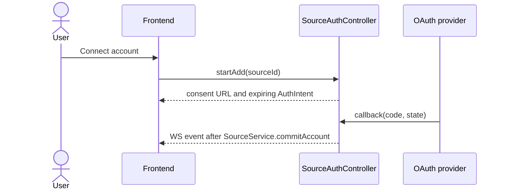

### Browser OAuth returns a provider URL and consumes one callback

When the user chooses Connect, `SourceAuthController.startAdd` records an
expiring intent and returns the provider's consent URL. The intent identifies
the user, Source and one callback:

```typescript
interface AuthIntent {
  readonly userId: string;
  readonly sourceId: string;
  readonly state: string;
  readonly expiresAt: string;
}
```

The registered callback consumes that intent once and exchanges the code.
`SourceService.commitAccount` saves the account before the frontend receives
the completion event. Expiry, a repeated callback or a provider error closes
the intent and commits nothing.


